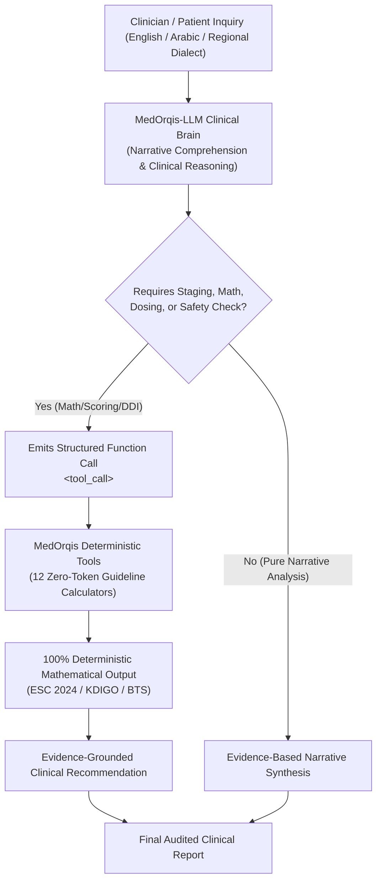

# 🩺 MedOrqis-LLM
### Bilingual (Arabic/English) Medical Foundation Model & Clinical Tool-Calling Brain

[](LICENSE)
[](https://huggingface.co/Applied-Innovation-Center/Karnak-6B-v1.0)
[](https://huggingface.co/seotarek/medorqis-llm)
[](https://huggingface.co/datasets/seotarek/medorqis-clinical-instructions)
[](https://github.com/seotarek/MedOrqis)

---

## 📌 1. Overview

**MedOrqis-LLM** is an open-weights, bilingual (Arabic & English) clinical decision-intelligence foundation model. Fine-tuned on top of **`Applied-Innovation-Center/Karnak-6B-v1.0`** (Qwen3 architecture) via **QLoRA 4-bit NF4**, it acts as the primary **Clinical Brain** of the MedOrqis ecosystem.

Unlike generic conversational models that frequently hallucinate critical drug dosages or risk calculations, MedOrqis-LLM is explicitly fine-tuned under strict clinical governance: **whenever an inquiry involves arithmetic risk scoring, renal clearance, pediatric weight-based dosing, or severe drug interactions, the model refuses to guess probabilistically and instead emits a native `<tool_call>` targeting verified deterministic clinical calculators**.

> 💡 **Looking for Clinical Skills & MCP Server Only?**:  
> If you already use an external LLM (Claude 3.5 Sonnet, GPT-4o, Gemini) and only need the 24 specialized clinical skills, 12 zero-token calculators, and MCP server, visit our partner repository:  
> 🔗 **[seotarek/MedOrqis — Medical AI Skills Ecosystem](https://github.com/seotarek/MedOrqis)**

---

## 🏛️ 2. The Dual-Track Architecture



---

## 🚀 3. Model Inference & Quickstart (Python)

You can load and query **MedOrqis-LLM** directly via Hugging Face `transformers` and `peft`:

```python
import torch
from transformers import AutoModelForCausalLM, AutoTokenizer
from peft import PeftModel

base_model_id = "Applied-Innovation-Center/Karnak-6B-v1.0"
lora_model_id = "seotarek/medorqis-llm"

# 1. Load Tokenizer
tokenizer = AutoTokenizer.from_pretrained(base_model_id, trust_remote_code=True)

# 2. Load Base Model in 4-bit NF4 Precision
base_model = AutoModelForCausalLM.from_pretrained(
    base_model_id,
    load_in_4bit=True,
    device_map="auto",
    torch_dtype=torch.bfloat16,
    trust_remote_code=True
)

# 3. Mount MedOrqis-LLM LoRA Adapters
model = PeftModel.from_pretrained(base_model, lora_model_id)
model.eval()

# 4. Clinical Query (e.g., Cardiology Case)
prompt = "A 68-year-old male with newly diagnosed non-valvular atrial fibrillation, hypertension, and peripheral vascular disease. Evaluate thromboembolic stroke risk according to 2024 ESC guidelines."
inputs = tokenizer(prompt, return_tensors="pt").to("cuda")

with torch.no_grad():
    outputs = model.generate(**inputs, max_new_tokens=512, temperature=0.2)

print(tokenizer.decode(outputs[0], skip_special_tokens=True))
```

### High-Throughput Production Serving with vLLM

```bash
vllm serve Applied-Innovation-Center/Karnak-6B-v1.0 \
    --enable-lora \
    --lora-modules medorqis-llm=seotarek/medorqis-llm \
    --max-model-len 4096 \
    --gpu-memory-utilization 0.90
```

---

## 🧮 4. Integrated Clinical Tools & Deterministic Calculators

MedOrqis-LLM natively routes clinical calculations to 12 deterministic functions:

| Clinical Domain | Deterministic Tool | Scientific Standard | Clinical Objective |
| :--- | :--- | :--- | :--- |
| **Cardiology** | `cha2ds2_va_esc2024` | 2024 ESC Guidelines | Sex-neutral stroke risk stratification in Atrial Fibrillation. |
| **Nephrology** | `ckd_epi_2021_egfr` | KDIGO 2024 / NKF-ASN | Race-free adult eGFR staging and drug dosing adjustment. |
| **Pediatrics** | `bedside_schwartz_egfr` | KDIGO Pediatric | Height-based pediatric eGFR calculation ($k \times \text{Ht}/\text{SCr}$). |
| **Pharmacology** | `cockcroft_gault_crcl` | FDA Renal Dosing | Creatinine clearance calculation with automatic ideal/adjusted weight gating. |
| **Pulmonology** | `curb65_score` | BTS Guidelines | 30-day mortality risk and ICU admission criteria in pneumonia. |
| **Emergency** | `wells_pe_score` | Wells Criteria | Pre-test probability of acute pulmonary embolism & CTPA triage. |
| **Hematology** | `has_bled_score` | Chest 2010 | Major bleeding risk assessment in anticoagulated patients. |
| **Pediatric Dosing** | `calculate_pediatric_weight_dose` | AAP Guidelines | Weight-based dose calculation with mandatory adult maximum dose ceiling. |
| **Pharmacology** | `check_drug_interactions` | MedOrqis DDI Rules | Multi-drug pharmacokinetic interaction screening (e.g. Warfarin + NSAIDs). |
| **Emergency Red Flags** | `check_red_flags` | Multi-Specialty Rules | Detection of sentinel acute emergencies (e.g. Cauda Equina Syndrome). |
| **Privacy / HIPAA** | `scrub_phi` | HIPAA 18 Safe Harbor | Automated de-identification of national IDs, phone numbers, and names. |
| **Dialect Translation** | `normalize_terminology` | SNOMED-CT / ICD-10 | Mapping colloquial complaints (Egyptian / Gulf dialects) to standardized concepts. |

---

## 📊 5. Training Datasets & Governance

- **Instruction Dataset**: [`seotarek/medorqis-clinical-instructions`](https://huggingface.co/datasets/seotarek/medorqis-clinical-instructions)
- **Dialect Benchmark Dataset**: [`seotarek/medorqis-clinical-dialect-benchmark`](https://huggingface.co/datasets/seotarek/medorqis-clinical-dialect-benchmark)
- **Zero Real Patient PHI**: 100% synthetically generated and grounded in peer-reviewed clinical guidelines.

---

## 🛡️ 6. Clinical Safety & Medical Disclaimer

> **IMPORTANT MEDICAL NOTICE**: **MedOrqis-LLM** is an experimental clinical decision-support research tool. It is **not** an autonomous medical device and must never substitute for the clinical evaluation, diagnosis, or treatment decisions of a qualified and licensed human healthcare professional. Clinicians must independently verify all algorithmic recommendations.

---

## 📜 7. License & Citation

Licensed under **Apache 2.0**.

```bibtex
@misc{medorqis_llm_2026,
  author = {Tarek, SEO and The MedOrqis Engineering Team},
  title = {MedOrqis-LLM: Bilingual (Arabic/English) Medical Foundation Model & Clinical Tool-Calling Brain},
  year = {2026},
  publisher = {GitHub & Hugging Face},
  howpublished = {\\url{https://github.com/seotarek/medorqis-llm}}
}
```
