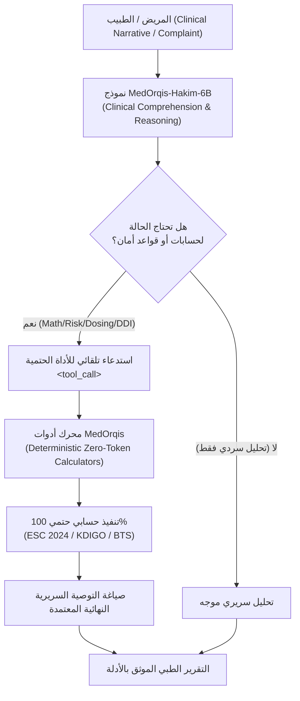

# 🩺 MedOrqis-Hakim-6B (حكيم)
### Bilingual Medical Foundation Model & Clinical Tool-Calling Brain
#### النموذج الطبي الذكي ثنائي اللغة لدعم القرار السريري واستدعاء الأدوات الحتمية

[](LICENSE)
[](https://huggingface.co/Applied-Innovation-Center/Karnak-6B-v1.0)
[](https://huggingface.co/seotarek/medorqis-hakim-6b)
[](https://huggingface.co/datasets/seotarek/medorqis-clinical-instructions)
[](https://github.com/seotarek/MedOrqis)

---

## 📌 1. نبذة عن النموذج (Overview)

**MedOrqis-Hakim (حكيم)** هو نموذج لغوي طبي سريري متخصص ثنائي اللغة (العربية والإنجليزية)، تم بناؤه ليعمل كـ **"العقل السريري المفكر" (The Clinical Brain)** القادر على:
- **تحليل التاريخ المرضي المعقد** وفهم التقارير المعملية والأشعة بدقة سريرية عالية.
- **تفسير وتطبيع اللهجات العربية الإقليمية** (العامية المصرية والخليجية) وترجمتها إلى مصطلحات طبية قياسية (ICD-10 و SNOMED-CT).
- **التكامل الحتمي مع الأدوات الطبية**: تم تدريب النموذج على الامتناع عن التخمين الذهني في الحسابات الطبية الحرجة، واستدعاء محركات وأدوات MedOrqis الحسابية تلقائياً (`<tool_call>`).

النموذج مبني فوق الأساس الطبي العربي **`Applied-Innovation-Center/Karnak-6B-v1.0`** (معمارية Qwen3) ومعزز بمحولات LoRA الطبية الموجهة.

> 💡 **تكامل المنظومة (Ecosystem Integration)**:  
> لتشغيل المهارات السريرية الـ 24 وخادم بروتوكول MCP، يرجى مراجعة المستودع الشقيق:  
> 🔗 **[seotarek/MedOrqis — Medical AI Skills Ecosystem](https://github.com/seotarek/MedOrqis)**

---

## 🏛️ 2. الهيكلية السريرية (Clinical Architecture)



---

## 🚀 3. تشغيل واستخدام النموذج (Model Inference & Serving)

### أ. التشغيل المباشر عبر Python (Transformers & PEFT)

```python
import torch
from transformers import AutoModelForCausalLM, AutoTokenizer
from peft import PeftModel

base_model_id = "Applied-Innovation-Center/Karnak-6B-v1.0"
lora_model_id = "seotarek/medorqis-hakim-6b"

# 1. تحميل الـ Tokenizer
tokenizer = AutoTokenizer.from_pretrained(base_model_id, trust_remote_code=True)

# 2. تحميل النموذج الأساسي بضغط 4-bit
base_model = AutoModelForCausalLM.from_pretrained(
    base_model_id,
    load_in_4bit=True,
    device_map="auto",
    torch_dtype=torch.bfloat16,
    trust_remote_code=True
)

# 3. دمج محولات الحكيم (Hakim LoRA Adapters)
model = PeftModel.from_pretrained(base_model, lora_model_id)
model.eval()

# 4. استعلام سريري
prompt = "مريض عمره 68 سنة يعاني من رجفان أذيني غير صمام وارتفاع ضغط دم. كيف نقيم خطورة الجلطات وفق ESC 2024؟"
inputs = tokenizer(prompt, return_tensors="pt").to("cuda")

with torch.no_grad():
    outputs = model.generate(**inputs, max_new_tokens=512, temperature=0.2)

print(tokenizer.decode(outputs[0], skip_special_tokens=True))
```

### ب. تشغيل النموذج عبر vLLM (High-Throughput Production Serving)

```bash
vllm serve Applied-Innovation-Center/Karnak-6B-v1.0 \
    --enable-lora \
    --lora-modules medorqis-hakim=seotarek/medorqis-hakim-6b \
    --max-model-len 4096 \
    --gpu-memory-utilization 0.90
```

---

## 🧮 4. القدرات السريرية واستدعاء الأدوات (Clinical Capabilities)

تم تدريب النموذج على توليد استدعاءات برمجية حتمية للأدوات الطبية التالية:

| النطاق السريري | الأداة المستدعاة | المرجع العلمي المعتمد | الوظيفة السريرية |
| :--- | :--- | :--- | :--- |
| **أمراض القلب** | `cha2ds2_va_esc2024` | ESC 2024 Guidelines | تقييم خطورة جلطات الرجفان الأذيني (بعد استبعاد عامل الجنس). |
| **أمراض الكلى** | `ckd_epi_2021_egfr` | KDIGO 2024 / NKF-ASN | حساب وظائف الكلى بالمعادلة الحديثة المعتمدة الخالية من العرق. |
| **طب الأطفال** | `bedside_schwartz_egfr` | KDIGO Pediatric | حساب كفاءة وظائف الكلى للأطفال دون سن 18 عاماً. |
| **طب الأطفال** | `calculate_pediatric_weight_dose` | AAP Protocols | حساب الجرعات الدوائية للأطفال حسب الوزن مع سقف جرعة البالغين. |
| **أمراض الصدر** | `curb65_score` | BTS Guidelines | تقييم شدة الالتهاب الرئوي وقبول العناية المركزة. |
| **الطوارئ والأوعية** | `wells_pe_score` | Wells Criteria | تحديد احتمالية الجلطة الرئوية وتوجيه الفحص الإشعاعي (CTPA). |
| **أمراض الدم والتخثر** | `has_bled_score` | Chest Guidelines | تقييم خطورة النزيف لمرضى مضادات التخثر. |
| **السلامة الدوائية** | `check_drug_interactions` | MedOrqis DDI Rules | كشف التداخلات الدوائية القاتلة والتعارضات المحظورة. |
| **الإنذار المبكر** | `check_red_flags` | Emergency Protocols | التقاط الطوارئ الحادة والحرجة فوراً (مثل: متلازمة ذنب الفرس). |
| **حماية الخصوصية** | `scrub_phi` | HIPAA Safe Harbor | التطهير الآلي لبيانات المرضى الشخصية والأرقام القومية. |
| **معالجة اللهجات** | `normalize_terminology` | SNOMED-CT / ICD-10 | ترجمة الشكاوى العامية (مثل: "كرشة نفس"، "حرقان فم المعدة") سريرياً. |

---

## 🛡️ 5. إخلاء المسؤولية الطبية والأمان (Clinical Disclaimer)

> **تنبيه سريري هام**: تم تطوير نموذج **MedOrqis-Hakim** لأغراض البحث العلمي ودعم القرار السريري التجريبي (Clinical Decision Support). النموذج ليس طبيباً مرخصاً ولا يحل محل الفحص الطبي السريري المباشر بواسطة طبيب بشري مؤهل. لا يجب استخدام المخرجات لاتخاذ قرارات علاجية حاسمة دون مراجعة طبية بشرية معتمدة.

---

## 📜 6. الترخيص والتوثيق (License & Citation)

النموذج والأكواد مرخصة تحت رخصة **Apache 2.0**.

```bibtex
@misc{medorqis_hakim_2026,
  author = {Tarek, SEO and The MedOrqis Engineering Team},
  title = {MedOrqis-Hakim-6B: Bilingual Medical Foundation Model & Clinical Tool-Calling Brain},
  year = {2026},
  publisher = {GitHub & Hugging Face},
  howpublished = {\\url{https://github.com/seotarek/medorqis-hakim}}
}
```
