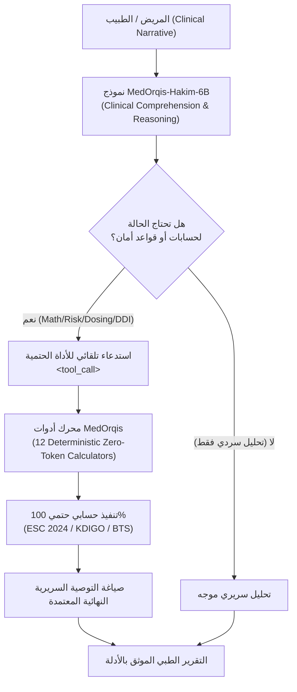

# 🩺 MedOrqis-Hakim-6B (حكيم)
### Bilingual Medical Foundation Model & Deterministic Clinical Tool-Calling Brain
#### النموذج الطبي الذكي ثنائي اللغة الموجه بالمعايير السريرية العالمية واستدعاء الأدوات الحتمية

[](LICENSE)
[](https://huggingface.co/Applied-Innovation-Center/Karnak-6B-v1.0)
[](https://huggingface.co/seotarek/medorqis-hakim-6b)
[](https://huggingface.co/datasets/seotarek/medorqis-clinical-instructions)
[](https://colab.research.google.com/github/seotarek/medorqis-hakim/blob/main/notebooks/MedOrqis_Free_Training_Colab.ipynb)
[](https://github.com/seotarek/MedOrqis)

---

## 📌 1. نبذة عن النموذج (Overview)

**MedOrqis-Hakim (حكيم)** هو نموذج لغوي طبي سريري متخصص ثنائي اللغة (العربية والإنجليزية)، تم تدريبه ليعمل كـ **"العقل الطبي المفكر" (The Clinical Brain)** القادر على فهم الشكاوى الطبية المعقدة، والتحاليل المعملية، واللهجات العامية الإقليمية (المصرية والخليجية)، وتوليد استدعاءات برمجية حتمية للأدوات الطبية (`<tool_call>`) بدلاً من التخمين الاحتمالي.

النموذج مبني فوق الأساس الطبي العربي **`Applied-Innovation-Center/Karnak-6B-v1.0`** (معمارية Qwen3 المتطورة) ومدرب بتقنية **4-bit QLoRA**.

> 💡 **هل تبحث عن المهارات السريرية فقط؟ (Looking for Skills & MCP only?)**:  
> إذا كنت طبيباً أو مطوراً تستخدم بالفعل نماذج مثل (Claude 3.5 Sonnet أو GPT-4o أو Gemini) وتريد فقط حاسبات MedOrqis السريرية وخادم الـ MCP والمهارات الـ 24، توجه إلى المستودع الشقيق:  
> 🔗 **[seotarek/MedOrqis — Medical AI Skills Ecosystem](https://github.com/seotarek/MedOrqis)**

---

## 🏛️ 2. الهيكلية ثنائية المسار (The Dual-Track Architecture)



---

## 🚀 3. التشغيل السريع في بايثون (Quickstart Inference)

يمكنك تحميل وتشغيل أوزان ومحولات النموذج مباشرة من Hugging Face باستخدام مكتبتي `transformers` و `peft`:

```python
import torch
from transformers import AutoModelForCausalLM, AutoTokenizer
from peft import PeftModel

base_model_id = "Applied-Innovation-Center/Karnak-6B-v1.0"
lora_model_id = "seotarek/medorqis-hakim-6b"

# 1. تحميل الـ Tokenizer
tokenizer = AutoTokenizer.from_pretrained(base_model_id, trust_remote_code=True)

# 2. تحميل النموذج الأساسي بضغط 4-bit
base_model = AutoModelForCausalLM.from_pretrained(
    base_model_id,
    load_in_4bit=True,
    device_map="auto",
    torch_dtype=torch.bfloat16,
    trust_remote_code=True
)

# 3. دمج محولات الحكيم (Hakim LoRA Adapters)
model = PeftModel.from_pretrained(base_model, lora_model_id)
model.eval()

# 4. توجيه استعلام سريري
prompt = "مريض عمره 68 سنة يعاني من رجفان أذيني غير صمام وارتفاع ضغط دم. كيف نقيم خطورة الجلطات وفق ESC 2024؟"
inputs = tokenizer(prompt, return_tensors="pt").to("cuda")

with torch.no_grad():
    outputs = model.generate(**inputs, max_new_tokens=512, temperature=0.2)

print(tokenizer.decode(outputs[0], skip_special_tokens=True))
```

---

## ⚡ 4. خيارات التدريب السحابي (Cloud Training)

### الخيار الأول: تدريب مجاني 100% عبر Google Colab (NVIDIA T4)
- **التكلفة**: **0$ (مجاني تماماً)**.
- **استهلاك جهازك/إنترنتك**: **0 بايت (كل شيء سحابي بالكامل داخل خوادم جوجل)**.
- **المدة**: ~20 دقيقة.
- **الدفتر الجاهز بنقرة واحدة**:  
  [](https://colab.research.google.com/github/seotarek/medorqis-hakim/blob/main/notebooks/MedOrqis_Free_Training_Colab.ipynb)

### الخيار الثاني: تدريب سحابي واسع النطاق على RunPod (NVIDIA A100)
- لتدريب النموذج على كروت A100 (80GB) بضغطة واحدة:
```bash
python3 training/runpod_manager.py launch --gpu "NVIDIA A100-PCIE-80GB"
```

---

## 📊 5. البيانات والأدوات المدعومة (Dataset & Tool-Calling)

- **مجموعة بيانات التدريب السريري التوليدي**: [`seotarek/medorqis-clinical-instructions`](https://huggingface.co/datasets/seotarek/medorqis-clinical-instructions)
- **الأدوات الحاسبية المدعومة في التدريب**:
  1. `calculate_clinical_score` (`cha2ds2_va_esc2024`): خطورة جلطات الرجفان الأذيني (ESC 2024).
  2. `calculate_clinical_score` (`ckd_epi_2021_egfr`): معادلة وظائف الكلى الخالية من العرق (KDIGO 2024).
  3. `calculate_clinical_score` (`bedside_schwartz_egfr`): كفاءة وظائف الكلى للأطفال.
  4. `calculate_clinical_score` (`curb65_score`): تقييم شدة الالتهاب الرئوي وقبول العناية المركزة.
  5. `calculate_clinical_score` (`wells_pe_score`): تشخيص احتمالية الجلطة الرئوية.
  6. `calculate_clinical_score` (`has_bled_score`): تقييم خطورة النزيف مع مضادات التخثر.
  7. `calculate_pediatric_weight_dose`: حساب جرعات الأطفال الدوائية مع سقف جرعة البالغين الصارم.
  8. `check_drug_interactions`: فحص التعارضات الدوائية القاتلة (مثل: Warfarin + NSAIDs).
  9. `check_red_flags`: التقاط الطوارئ الجراحية والحرجة فوراً (مثل: متلازمة ذنب الفرس).
  10. `scrub_phi`: تطهير الأسماء والأرقام القومية والهواتف لضمان خصوصية المرضى (HIPAA).
  11. `normalize_terminology`: ترجمة الشكاوى العامية المصرية والخليجية إلى تشخيصات معيارية (SNOMED-CT / ICD-10).

---

## 🛡️ 6. إخلاء المسؤولية الطبية والأمان (Clinical Disclaimer)

> **تنبيه سريري هام**: تم تطوير نموذج **MedOrqis-Hakim** لأغراض البحث العلمي ودعم القرار السريري التجريبي (Clinical Decision Support). النموذج ليس طبيباً مرخصاً ولا يحل محل الفحص الطبي السريري المباشر بواسطة طبيب بشري مؤهل. لا يجب استخدام المخرجات لاتخاذ قرارات علاجية حاسمة دون مراجعة طبية بشرية معتمدة.

---

## 📜 7. الترخيص والتوثيق (License & Citation)

النموذج والأكواد مرخصة تحت رخصة **Apache 2.0**.

```bibtex
@misc{medorqis_hakim_2026,
  author = {Tarek, SEO and The MedOrqis Engineering Team},
  title = {MedOrqis-Hakim-6B: Bilingual Medical Foundation Model & Clinical Tool-Calling Brain},
  year = {2026},
  publisher = {GitHub & Hugging Face},
  howpublished = {\\url{https://github.com/seotarek/medorqis-hakim}}
}
```
