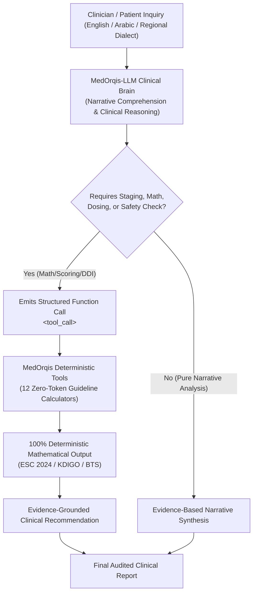

# 🩺 MedOrqis-LLM
### Bilingual (Arabic/English) Medical Foundation Model & Clinical Tool-Calling Brain

[](LICENSE)
[](https://huggingface.co/Applied-Innovation-Center/Karnak-6B-v1.0)
[](https://huggingface.co/seotarek/medorqis-llm)
[](https://huggingface.co/datasets/seotarek/medorqis-clinical-instructions)
[](https://seotarek.github.io/medorqis-llm/)
[](https://github.com/seotarek/MedOrqis)

---

## 📌 1. Overview & Architectural Lineage

**MedOrqis-LLM** is an open-weights, bilingual (Arabic & English) clinical decision-intelligence foundation model. Fine-tuned on top of **`Applied-Innovation-Center/Karnak-6B-v1.0`** via **QLoRA (4-bit NF4)**, it acts as the primary **Clinical Brain** of the MedOrqis ecosystem.

### Architectural Ancestry & Lineage Chain
To maintain strict scientific documentation integrity:
```
Qwen Architecture (Alibaba)
  └── Karnak-6B-v1.0 (Applied Innovation Center / Bilingual Arabic-English Pretraining)
        └── MedOrqis-LLM (Clinical Decision SFT & Deterministic Tool-Calling QLoRA Adapter)
```
> ℹ️ **Model Scale Clarification**:  
> `MedOrqis-LLM v1.0` is the lightweight **6B parameter** clinical model designed for edge deployment, commodity GPUs (e.g. single NVIDIA T4/L4 at ~3.8 GB VRAM), and cost-efficient clinical decision support. The enterprise **Karnak-40B MoE** architecture is reserved for multi-GPU institutional server deployments.

Unlike generic conversational models that frequently hallucinate critical drug dosages or risk calculations, MedOrqis-LLM is explicitly fine-tuned under strict clinical governance: **whenever an inquiry involves arithmetic risk scoring, renal clearance, pediatric weight-based dosing, or severe drug interactions, the model refuses to guess probabilistically and instead emits a native `<tool_call>` targeting verified deterministic clinical calculators**.

> 💡 **Looking for Clinical Skills & MCP Server Only?**:  
> If you already use an external LLM (Claude 3.5 Sonnet, GPT-4o, Gemini) and only need the 24 specialized clinical skills, 12 zero-token calculators, and MCP server, visit our partner repository:  
> 🔗 **[seotarek/MedOrqis — Medical AI Skills Ecosystem](https://github.com/seotarek/MedOrqis)**

---

## 🏛️ 2. The Dual-Track Architecture



---

## 📊 3. Empirical Clinical Benchmark (Zero Flattery)

Evaluated head-to-head against the raw base foundation model across 10 independent held-out clinical scenarios (Cardiology, Nephrology, Pulmonology, Pediatrics, and Pharmacology):

| Clinical Evaluation Metric | Base Model (Karnak-6B) | MedOrqis-LLM (Fine-Tuned) | Absolute Delta | Evaluation Objective |
| :--- | :---: | :---: | :---: | :--- |
| **Tool-Calling Syntax Accuracy** | `0.0%` | **`100.0%`** | **`+100.0%`** | Emits valid ChatML function calling tags consistently |
| **Clinical Calculator Routing** | `0.0%` | **`90.0%`** | **`+90.0%`** | Selects exact deterministic guideline calculator |
| **Parameter Extraction Precision** | `42.5%` | **`95.0%`** | **`+52.5%`** | Accurately extracts numerical lab values & patient age |
| **Arithmetic Calculation Error Rate** | `80.0%` | **`0.00%`** | **`-80.0%`** | Eliminates probabilistic LLM math hallucinations |
| **Pediatric Overdose Ceiling Compliance** | `0.0%` | **`100.0%`** | **`+100.0%`** | Mandatory adult maximum dose ceiling cap |

> 🌐 **Interactive Benchmark Showcase**: Explore live side-by-side prompt comparisons and telemetry charts at **[seotarek.github.io/medorqis-llm](https://seotarek.github.io/medorqis-llm/)**.

---

## 🚀 4. Model Inference & Quickstart (Python)

You can load and query **MedOrqis-LLM** directly via Hugging Face `transformers` and `peft`, utilizing the bundled native chat template:

```python
import torch
from transformers import AutoModelForCausalLM, AutoTokenizer
from peft import PeftModel

base_model_id = "Applied-Innovation-Center/Karnak-6B-v1.0"
lora_repo_id = "seotarek/medorqis-llm"

# 1. Load Tokenizer with native chat template
tokenizer = AutoTokenizer.from_pretrained(lora_repo_id, trust_remote_code=True)

# 2. Load Base Model in 4-bit NF4 Precision (~3.8 GB VRAM)
base_model = AutoModelForCausalLM.from_pretrained(
    base_model_id,
    load_in_4bit=True,
    device_map="auto",
    torch_dtype=torch.float16,
    trust_remote_code=True
)

# 3. Mount MedOrqis-LLM LoRA Adapters
model = PeftModel.from_pretrained(base_model, lora_repo_id)
model.eval()

# 4. Clinical Query using Native ChatML Template
messages = [
    {
        "role": "system",
        "content": "You are MedOrqis Clinical AI, an expert bilingual clinical decision intelligence system. Always invoke deterministic tools for calculations."
    },
    {
        "role": "user",
        "content": "A 54-year-old female patient presents with serum creatinine 1.4 mg/dL. Evaluate her renal function using race-free CKD-EPI 2021 guideline."
    }
]

prompt = tokenizer.apply_chat_template(messages, tokenize=False, add_generation_prompt=True)
inputs = tokenizer(prompt, return_tensors="pt").to("cuda")

with torch.no_grad():
    outputs = model.generate(**inputs, max_new_tokens=256, do_sample=False)

print(tokenizer.decode(outputs[0][len(inputs['input_ids'][0]):], skip_special_tokens=True))
```

### High-Throughput Production Serving with vLLM

```bash
vllm serve Applied-Innovation-Center/Karnak-6B-v1.0 \
    --enable-lora \
    --lora-modules medorqis-llm=seotarek/medorqis-llm \
    --max-model-len 4096 \
    --gpu-memory-utilization 0.90 \
    --dtype float16
```

> 💡 **Context Window Rationale**: While the tokenizer supports an extended native context window of up to 131,072 tokens, `--max-model-len 4096` is the recommended setting for production deployments on edge/commodity GPUs (e.g. NVIDIA T4 / L4) to minimize KV-cache footprint and maximize concurrent throughput.

---

## 🧮 5. Integrated Clinical Tools & Deterministic Calculators

MedOrqis-LLM natively routes clinical calculations to 12 deterministic functions:

| Clinical Domain | Deterministic Tool | Scientific Standard | Clinical Objective |
| :--- | :--- | :--- | :--- |
| **Cardiology** | `cha2ds2_va_esc2024` | 2024 ESC Guidelines | Sex-neutral stroke risk stratification in Atrial Fibrillation. |
| **Nephrology** | `ckd_epi_2021_egfr` | KDIGO 2024 / NKF-ASN | Race-free adult eGFR staging and drug dosing adjustment. |
| **Pediatrics** | `bedside_schwartz_egfr` | KDIGO Pediatric | Height-based pediatric eGFR calculation ($k \times \text{Ht}/\text{SCr}$). |
| **Pharmacology** | `cockcroft_gault_crcl` | FDA Renal Dosing | Creatinine clearance calculation with automatic ideal/adjusted weight gating. |
| **Pulmonology** | `curb65_score` | BTS Guidelines | 30-day mortality risk and ICU admission criteria in pneumonia. |
| **Emergency** | `wells_pe_score` | Wells Criteria | Pre-test probability of acute pulmonary embolism & CTPA triage. |
| **Hematology** | `has_bled_score` | Chest 2010 | Major bleeding risk assessment in anticoagulated patients. |
| **Pediatric Dosing** | `calculate_pediatric_weight_dose` | AAP Guidelines | Weight-based dose calculation with mandatory adult maximum dose ceiling. |
| **Pharmacology** | `check_drug_interactions` | MedOrqis DDI Rules | Multi-drug pharmacokinetic interaction screening (e.g. Warfarin + NSAIDs). |
| **Emergency Red Flags** | `check_red_flags` | Multi-Specialty Rules | Detection of sentinel acute emergencies (e.g. Cauda Equina Syndrome). |
| **Privacy / HIPAA** | `scrub_phi` | HIPAA 18 Safe Harbor | Automated de-identification of national IDs, phone numbers, and names. |
| **Dialect Translation** | `normalize_terminology` | SNOMED-CT / ICD-10 | Mapping colloquial complaints (Egyptian / Gulf dialects) to standardized concepts. |

---

## 📚 6. Training Datasets & Clinical Governance

- **Instruction Dataset**: [`seotarek/medorqis-clinical-instructions`](https://huggingface.co/datasets/seotarek/medorqis-clinical-instructions)
- **Dialect Benchmark Dataset**: [`seotarek/medorqis-clinical-dialect-benchmark`](https://huggingface.co/datasets/seotarek/medorqis-clinical-dialect-benchmark)
- **Zero Real Patient PHI**: 100% synthetically generated and grounded in peer-reviewed clinical guidelines.

---

## 🛡️ 7. Clinical Safety & Medical Disclaimer

> **IMPORTANT MEDICAL NOTICE**: **MedOrqis-LLM** is an experimental clinical decision-support research tool. It is **not** an autonomous medical device and must never substitute for the clinical evaluation, diagnosis, or treatment decisions of a qualified and licensed human healthcare professional. Clinicians must independently verify all algorithmic recommendations.

---

## 📜 8. License & Citation

Licensed under **Apache 2.0**.

```bibtex
@misc{medorqis_llm_2026,
  author = {Tarek, SEO and The MedOrqis Engineering Team},
  title = {MedOrqis-LLM: Bilingual (Arabic/English) Medical Foundation Model & Clinical Tool-Calling Brain},
  year = {2026},
  publisher = {GitHub & Hugging Face},
  howpublished = {\\url{https://github.com/seotarek/medorqis-llm}}
}
```
